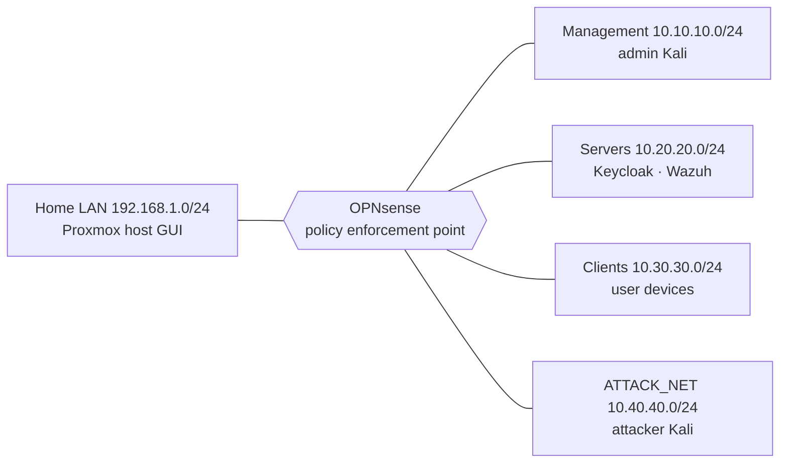
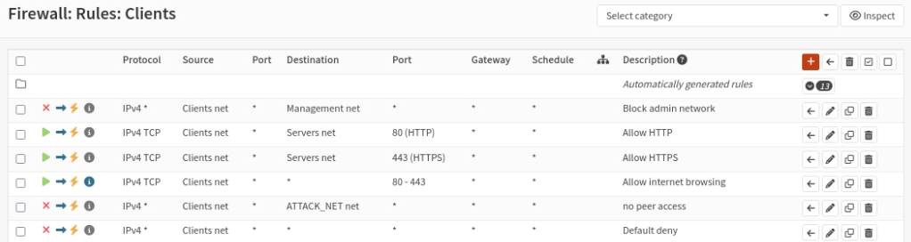
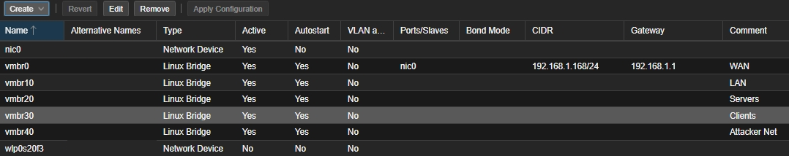

# Zero Trust Network Access homelab

A segmented lab on Proxmox for testing **Zero Trust Network Access (ZTNA)**. It combines a firewall as the policy enforcement point, a self-hosted identity provider, an identity-aware overlay network and a SIEM.

It started as my university project, *Assessing the Effectiveness of Zero Trust Network Access in Dynamic Networks* (spring 2026). In November 2026 I booted it back up and audited the live configuration against my own write-up. This repo tracks what I found, what I fixed, and where the lab is going next.

> **Where it's heading:** Keycloak (identity + MFA) → NetBird (network access by identity) → OPNsense (segmentation) → Wazuh (detection). Everything is self-hosted, and every layer checks identity.

---

## Architecture



| Component | Role | Runs as |
|---|---|---|
| **Proxmox VE 9.1** | Hypervisor | Bare metal (laptop: i7-8750H, 16 GB RAM) |
| **OPNsense 26.1** | Firewall between every segment; DNS resolver | VM, one virtual NIC per segment |
| **Keycloak 26** | Identity provider: realm `ZTNA-LAB`, role-based groups, OTP | Docker on Ubuntu Server (Servers net) |
| **Wazuh** | SIEM, with agents on the lab hosts | VM (Servers net) |
| **Tailscale** → **NetBird** | Identity-aware overlay network (migration in progress) | Agents on the nodes |
| **Kali Linux ×2** | Admin workstation (Management) and attacker (ATTACK_NET) | VMs |

Every segment is a separate Linux bridge with **no IP address on the hypervisor**, so all traffic between segments must pass through OPNsense.

---

## Progress

- [x] Audit the live lab against the original write-up
- [x] Remove the hypervisor's IP addresses from the lab bridges
- [x] Renumber the Clients segment to match the addressing plan
- [x] Point server DNS at the firewall only
- [x] Rebuild the **Servers**, **Clients** and **ATTACK_NET** firewall rules to least privilege, and verify them
- [x] Free hypervisor disk space (49 GB) and right-size VM memory
- [ ] Rebuild the **Management** firewall rules
- [ ] Full attack test run from ATTACK_NET (Nmap, Nikto, Hydra)
- [ ] Forward firewall logs to Wazuh
- [ ] Keycloak hardening: enforce MFA, brute-force detection, password policy, permanent admin
- [ ] Replace Tailscale with **self-hosted NetBird**, using Keycloak SSO and an internal CA ([plan](docs/netbird-migration.md))
- [ ] Proxmox: 2FA for root, backup retention

---

## What the audit found (November 2026)

| # | Finding | Risk | Fix | Status |
|---|---|---|---|---|
| 1 | Servers tab started with an enabled **pass-any** rule | Rules are first-match, so every block rule below it was dead | Rebuilt: named services only, logged blocks, default deny | ✅ Verified |
| 2 | Clients "internet browsing" rule allowed **any destination on ports 80–443** (a 364-port range), above the block for ATTACK_NET | Clients could reach the attacker network, the firewall admin page and the home router | Internet allowed only to non-private addresses (`!RFC1918`), on 80 and 443 | ✅ Verified |
| 3 | ATTACK_NET was allowed to "WAN net" | "WAN net" is the **home LAN**, including the hypervisor GUI, not the internet | Only the published login page and the internet allowed; all private ranges blocked and logged | ✅ Verified |
| 4 | The hypervisor had IP addresses on the lab bridges | A foothold in each segment that the firewall couldn't filter | IPs removed; only the WAN bridge is addressed | ✅ Done |
| 5 | Logging was off on almost every rule | Blocked attacks left no evidence | Every block and default deny is logged | ✅ Done |
| 6 | Servers used a public DNS resolver alongside the firewall | DNS bypassed the firewall's policy | Firewall resolver only | ✅ Done |
| 7 | Hypervisor disk 100% full; the backup job had failed since April with no retention | No working backups; VMs at risk | 49 GB of stale backups and ISOs removed | ⏳ Retention pending |
| 8 | Keycloak had been stopped for a month without anyone noticing | An identity provider outage is a security event | Restart policy set | ✅ Done |
| 9 | Keycloak: temporary admin, no brute-force protection, no password policy, MFA optional, plain HTTP | Weak identity layer | Hardening plus HTTPS via the NetBird migration | ⏳ Planned |
| 10 | Tailscale: default allow-all policy; the attacker VM enrolled in the tailnet; personal Google sign-in | The overlay network could bypass the firewall's segmentation | Migrating to NetBird with Keycloak as the identity provider | ⏳ In progress |
| 11 | The documented rules and diagram didn't match the live configuration | The write-up overstated the protection | This repo: config as code, verified by tests | ✅ Ongoing |

### Before and after: client segment

**Before:** the broad "80–443 to anywhere" rule sits above the block for ATTACK_NET.



**After:** DNS to the firewall, then two named services (Keycloak sign-in, Wazuh telemetry), then logged blocks to every other segment, the firewall and all private ranges, then internet-only NTP and web, then a logged default deny. Full tables for every segment are in [docs/opnsense-rules.md](docs/opnsense-rules.md).

### Hypervisor off the lab networks



---

## Verification

Tests run from the Keycloak server after the Servers rebuild:

| Test | Before | After |
|---|---|---|
| Firewall admin page (443) | Connected | Timed out |
| Proxmox GUI (8006) | Connected | Timed out |
| Attacker VM (22) | Reached (port answered) | Timed out |
| Admin Kali (22) | — | Timed out |
| Package mirror (80) | Connected | Connected |

The full test matrix covers the attacker, server, admin and client cases (A1–A9, S1–S5, M1–M4 and C1–C3). It's in [docs/opnsense-rules.md](docs/opnsense-rules.md#step-4-verification-matrix).

---

## Repository layout

```
docs/
  opnsense-rules.md      Least-privilege ruleset v2: aliases, per-segment rules, log forwarding, tests
  netbird-migration.md   Plan to replace Tailscale with self-hosted NetBird + Keycloak (internal CA)
configs/
  tailscale-policy.hujson  Least-privilege Tailscale policy (superseded by NetBird; kept for reference)
images/                  Evidence screenshots (cropped)
```

---

## Lessons learned

- **A design document isn't a security control.** The most valuable finding was the gap between what I'd written and what was actually configured.
- **Rule order matters more than rule count.** A single early pass rule silently disabled four block rules.
- **"WAN" isn't "the internet" in a homelab.** It's your home network, hypervisor included. "Internet" should be written as *not private address space*.
- **Your management plane is part of the attack surface.** Hypervisor interfaces on lab networks undo the segmentation.
- **Availability is a security property.** An identity provider that quietly stops is a gap in every control that depends on it.

---

*All addresses are private RFC 1918 ranges inside an isolated lab. No credentials, keys or configuration backups are stored in this repository.*
